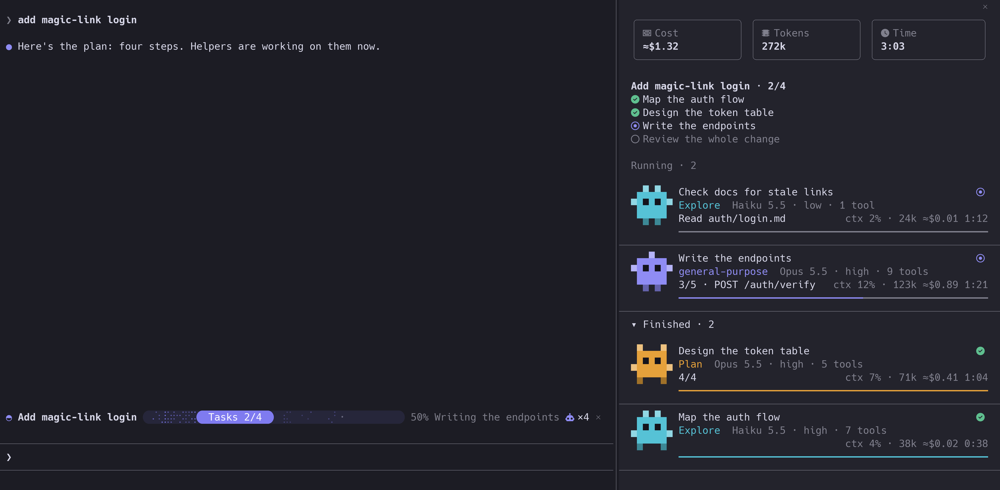

# claude-code-mods

Mods for [Claude Code](https://code.claude.com): small plugins that change its interface and behavior.

## Mods

| Mod | What it does |
|---|---|
| [crew-progress](plugins/crew-progress) | Progress bar above the prompt and a live panel of subagents. Works in any session, with no setup. |
| [file-tree](plugins/file-tree) | A live file tree beside the chat that lights up the files Claude reads, edits and commits. |



## Installing a mod

At the prompt of a terminal session, with the mod's name:

```
/plugin install crew-progress --marketplace erictran308/claude-code-mods
```

Answer `y` to add the marketplace, then choose a scope. Each mod's own README lists its commands and settings.

## Working on these mods

Each mod lives in its own folder under `plugins/`:

```
.claude-plugin/marketplace.json   lists every mod
plugins/<mod>/
  .claude-plugin/plugin.json      name, version, settings
  hooks/hooks.json                points at the hooks module
  hooks/register.tsx              the mod
  hooks/*.test.tsx                its tests
  types/index.d.ts                the state it keeps, if any
  README.md
scripts/check.sh                  validates and tests everything
```

To try a mod, start a session with it loaded. It reloads when you save:

```
claude --plugin-dir plugins/<mod>
```

To add a mod:

1. Create `plugins/<mod>/`, with the folder name matching `name` in its `plugin.json`.
2. Give it a `README.md` and tests.
3. Add an entry to `.claude-plugin/marketplace.json`, with the same `version` as its `plugin.json`.
4. Run `scripts/check.sh`.

To release a change, raise `version` in both `plugin.json` and `marketplace.json`, then run `scripts/check.sh`.

`scripts/check.sh` needs `claude` and `jq`.

`scripts/build-file-tree-icons.mjs` rebuilds the picture icons of `file-tree` from Material Icon Theme. It needs `node` and `magick`, and its first lines say how to run it.

## License

[MIT](LICENSE). Each mod's folder lists any third-party notices.
