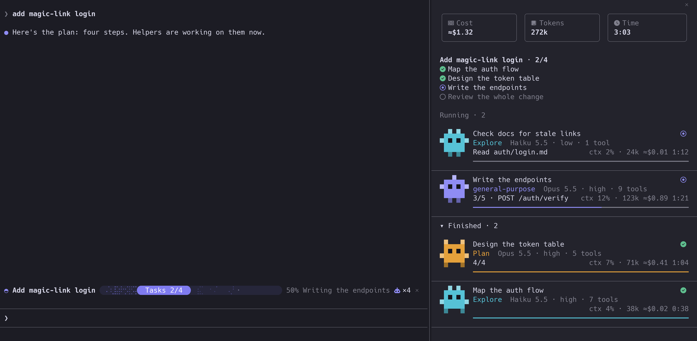

# crew-progress

A Claude Code mod that shows how far along Claude is: a progress bar above the prompt and a live panel of every subagent. It works in any session, with no setup and no companion skill.



*Drawn from the mod's own rendering code with sample data.*

## Install

At the prompt of a terminal session:

```
/plugin install crew-progress --marketplace erictran308/claude-code-mods
```

Answer `y` to add the marketplace, then choose a scope. From a shell, use `claude plugin install crew-progress --marketplace erictran308/claude-code-mods`.

In the desktop app, click + next to the prompt box, then Plugins, Add marketplace with `erictran308/claude-code-mods`, then Add plugin.

## What it shows

**The bar** appears once there is a plan or a subagent. It shows the job's title, a rounded progress pill with the count inside, the percent, what is happening now, and the number of subagents. The dots ahead of the pill mark work in flight. Press ✕ to hide it; new work brings it back. It clears by itself when you send a new prompt after everything has finished.

**The Crew panel** lists the plan and every subagent: running, finished, failed and stopped. Skills that run as their own subagent, such as `/code-review`, appear too, named for the command. Each row has a small robot colored by agent type, the model and effort, tool calls, what it is doing right now, context used, estimated cost and time. Click a row's title to open that subagent's transcript.

## Using it

| To | Do |
|---|---|
| Open or close the panel | `/crew` |
| Only open it | `/crew open` |
| Open it from the bar with the keyboard | `ctrl+x tab`, `tab` to reach `×N`, `enter` |
| Close it with the keyboard | `ctrl+x tab` until it has focus, then `ctrl+x x` |

## Settings

Change these in `/config`.

| Setting | Values | Default |
|---|---|---|
| `autoOpen` | `first-agent` opens the panel once per session when the first subagent starts. `never` leaves it to you. | `first-agent` |
| `glyphs` | `nerd` draws the rounded bar and icons and needs a [Nerd Font](https://www.nerdfonts.com) in your terminal. `plain` uses standard Unicode only. | `nerd` |

If you see empty boxes on the bar, your terminal has no Nerd Font: set `glyphs` to `plain`.

## How it knows the progress

1. **Claude's own task list**, when the session has one. The mod only reads it, so it adds no tool and costs no tokens.
2. **A small `progress` tool**, added only in interactive sessions that have no task list. Claude calls it to report its plan.
3. **Counting subagents**, when there is no plan at all.

## Good to know

- The pill, robots and tiles are drawn in the terminal. The desktop app and VS Code get a plain text version.
- Costs are estimates from token counts and Anthropic's list prices. They cover subagents only, and a model the mod does not know counts as $0.00.
- A panel opened automatically needs a terminal at least 144 columns wide. `/crew` opens it at any width.
- Built and tested on Claude Code 2.1.319. The mod API is in early access, so a later release may need changes.

## Credits

Inspired by [Savvy Progress](https://github.com/JohnnyVizz/claude-kit/tree/main/plugins/savvy-progress) by johnnyvizz. The terminal drawing ports techniques from [ratatui](https://github.com/ratatui/ratatui). See [THIRD_PARTY_NOTICES.md](THIRD_PARTY_NOTICES.md).

MIT licensed.
