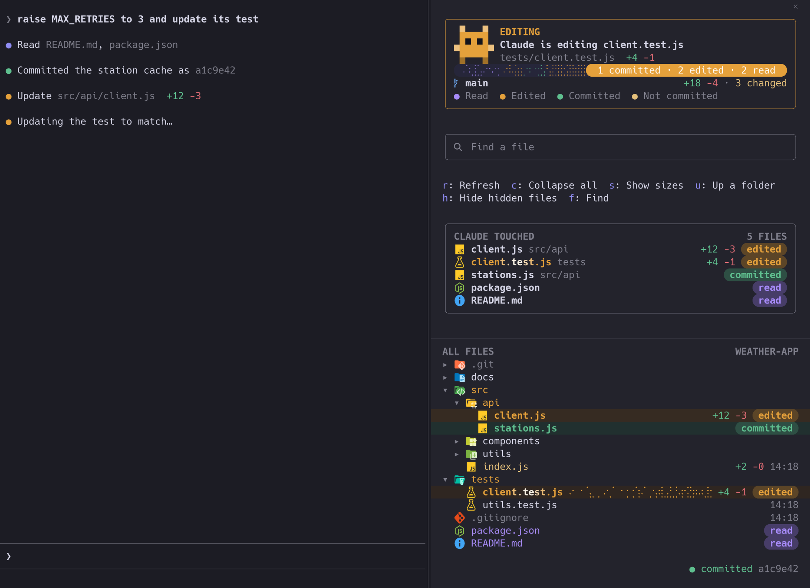

# file-tree

A Claude Code mod that puts your project's file tree beside the chat and lights up the files Claude reads, edits and commits, as it happens.



*Drawn from the mod's own rendering code with sample data.*

## Install

At the prompt of a terminal session:

```
/plugin install file-tree --marketplace erictran308/claude-code-mods
```

Answer `y` to add the marketplace, then choose a scope. Choose `user` to have it in every project. From a shell, use `claude plugin install file-tree --marketplace erictran308/claude-code-mods --scope user`.

File icons are full-color pictures from [Material Icon Theme](https://github.com/material-extensions/vscode-material-icon-theme) on Ghostty, kitty and iTerm2 3.5 or later, and need no font. Other terminals, tmux and ssh get rounded chips instead, which need a [Nerd Font](https://www.nerdfonts.com). Set **Terminal icons** to `plain` in `/config` if your terminal has none.

## What it shows

**The card** at the top says what Claude is doing right now, then what it did in the last turn: a small robot that works while Claude works, a strip of the turn's reads, edits and commits, the branch, and how many lines and files are changed.

**Claude touched** lists every file of the session, newest first, with its line counts and where it stands: `read`, `edited` or `committed`.

**All files** is the tree. Folders with Claude's work in them open by themselves and take its color. A file Claude is working on shimmers and glows for a moment, then keeps its color and pill. Folders opened only for reading close again after 15 seconds of quiet. Folders holding an edit stay open.

| Color | Means |
|---|---|
| Purple | Claude read it |
| Orange | Claude edited it |
| Green | Claude's edit is committed |
| Yellow | Changed, not committed, and not by Claude |

## Using it

| To | Do |
|---|---|
| Open or close the panel | `/tree` |
| Only open it | `/tree open` |
| Open or close a folder | Click it |
| Add a file to your prompt as an `@` mention | Click it |
| Jump to a touched file in the tree | Click it in Claude touched |
| Give the panel the keyboard | `ctrl+x tab` until it has focus |
| Walk its rows and buttons | `tab`, then `enter` to press |
| Scroll it | Arrow keys or the wheel |
| Close it from the keyboard | `ctrl+x x` while it has focus |

With the panel focused, single keys press its buttons:

| Key | Button |
|---|---|
| `f` | Find a file |
| `r` | Refresh |
| `c` | Collapse all |
| `s` | Show sizes or dates |
| `u` | Up a folder |
| `b` | Back to project |
| `h` | Hide or show hidden files |

## Settings

Change these in `/config`.

| Setting | Values | Default |
|---|---|---|
| Open the file tree | `first-edit`: once per session, when Claude first edits a file, and only in fullscreen where the panel docks beside the chat. Using `/tree` yourself turns this off for the session. `never`: only with `/tree`. | `first-edit` |
| File icons | `auto`: pictures where the terminal can draw them, chips elsewhere. `images`: always try pictures, for tmux with `allow-passthrough` or ssh. `chips`: never use pictures. | `auto` |
| Terminal icons | `nerd`, `plain`. Applies to chips and the other symbols. | `nerd` |

## How it knows

- `Read`, `Edit`, `Write` and `NotebookEdit` name their files.
- MCP tools count when they name a path and their tool name says read or write. Searches do not count as reads.
- Shell commands count as reads for `cat`, `head`, `tail`, `sed -n`, `less`, `wc` and `fw read`.
- Anything else a shell or MCP tool changes is found afterwards: files git sees as changed, or files in open folders outside git, whose date falls within that call. Commands known only to look, such as `ls` or `git status`, are skipped. A save of your own during a build or script can still be counted as Claude's.
- A commit is noticed from git's reflog, so a checkout, pull or reset does not count. Only files Claude edited turn green.
- With the panel closed, nothing is scanned: changes are picked up when you open it.

Line counts and branch need git. Everything else works in any folder. The colors are chosen for dark terminals.

The panel only reads your files. It runs `git status`, `diff`, `log`, `show`, `rev-parse` and `ls-files`, all with optional locks off.

## Notices

Inspired by [claude-code-filetree](https://github.com/data-goblin/claude-code-filetree), and by [real-icons.nvim](https://github.com/Mirsmog/real-icons.nvim) for drawing Material icons as pictures. See [THIRD_PARTY_NOTICES.md](THIRD_PARTY_NOTICES.md).
